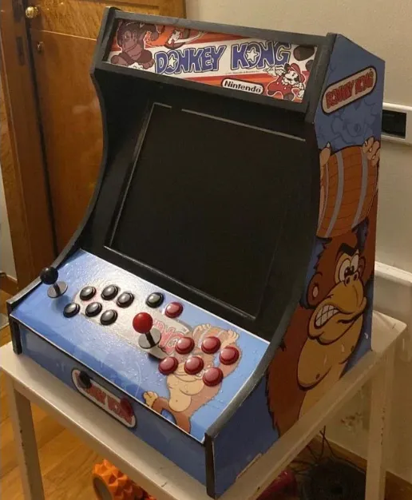
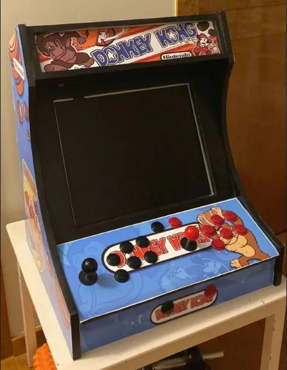
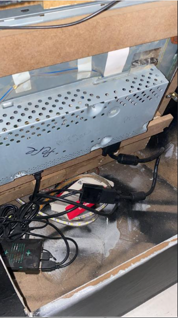
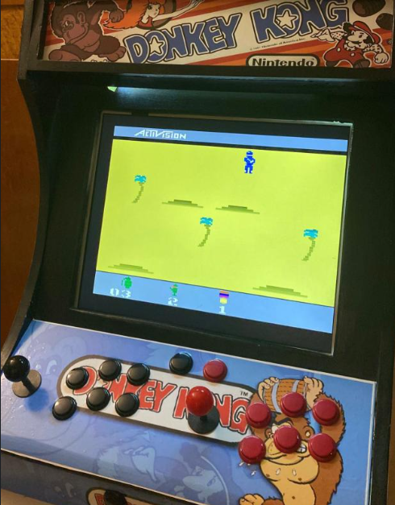

# Tabletop Arcade Machine

A two-player tabletop arcade cabinet built around a Raspberry Pi, with more than 14,000 retro games. I designed, built, wired and set it up myself over about a year, from cutting the wood to designing the artwork, and then sold it to a fellow gaming enthusiast.

  
  

## Specs

| | |
|---|---|
| Brain | Raspberry Pi running RetroPie |
| Games | 14,000+ |
| Players | 2, each with 1 joystick and 6 buttons, on USB zero-delay encoders |
| Screen | 17-inch computer monitor over HDMI, built into the cabinet |
| Sound | Two front speakers with a small amplifier |
| Lighting | LED strip |
| Power | Internal power strip behind a single external switch |
| Cabinet | Wood, cut by hand with a saw |
| Artwork | Donkey Kong-themed vinyls, designed in Photoshop |
| Maintenance | Rear door for access to the electronics and ventilation |

## How I built it

### 1. Design

I chose a bartop (tabletop) format: small enough to sit on a table, but with a full-size two-player control panel. The layout puts each player's joystick on the left of their six buttons, the standard arcade arrangement, so the machine feels familiar to anyone who has played in an arcade.

From the start I designed it to be maintained, not just finished: the electronics sit behind a rear door, with room for ventilation, instead of being sealed inside the cabinet.

### 2. Cabinet

I bought the wood and cut every panel by hand with a saw: the curved side panels, the angled control panel, the screen frame and the marquee at the top. Then I assembled the structure and painted the visible edges black to frame the artwork.

### 3. Artwork

I designed all the vinyls in Photoshop around a Donkey Kong theme: the marquee, both side panels, the control panel and the front plate. Each piece had to be sized to the exact dimensions of the panel I had cut, and to leave the holes for the joysticks and buttons in the right place.

### 4. Electronics

I bought a zero-delay arcade kit (joysticks, buttons, cables and one USB encoder board per player) and did all the wiring myself:

- **Controls:** each button and joystick is wired to its player's encoder board with spade connectors, and each board plugs into the Raspberry Pi over USB, where it shows up as a game controller.
- **Screen:** a 17-inch computer monitor, mounted inside the cabinet behind the screen frame and connected to the Pi over HDMI.
- **Sound:** the two front speakers are driven by a small amplifier fed from the Pi's audio output.
- **Lighting and power:** the LED strip has its own power supply. An internal power strip feeds the monitor, the Pi and the LEDs, and a single external switch turns the whole machine on and off.

  

### 5. Software

I flashed RetroPie onto the Pi's microSD card with balenaEtcher, mapped both players' controls in EmulationStation on first boot, and loaded a library of more than 14,000 games, so the machine boots straight into the game menu and works out of the box for two players.

  

## The hard part

Fitting everything into a compact tabletop cabinet: a 17-inch monitor, two speakers, an LED strip, the Raspberry Pi, the power supply and the wiring for two full control panels, while keeping enough airflow and leaving it all reachable through the rear door. Planning where each component goes, before cutting the wood, was as important as the build itself.

## What I learned

- **Woodwork:** measuring, cutting and assembling a structure that has to be rigid and look good.
- **Electronics:** wiring and testing a full set of controls, audio, lighting and power.
- **Embedded setup:** installing and configuring RetroPie and the controllers on a Raspberry Pi.
- **Graphic design:** turning panel measurements into print-ready artwork in Photoshop.
- **Finishing a product:** taking a project from an idea to something good enough that someone wanted to buy it.

## Notes

The software configuration files weren't kept, so this repository documents the build and the setup rather than the code.
